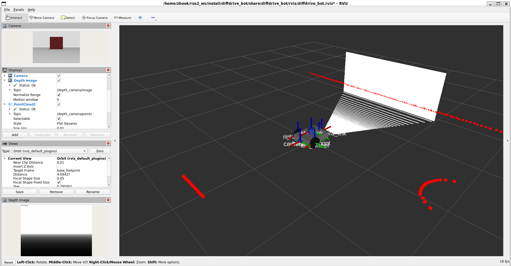
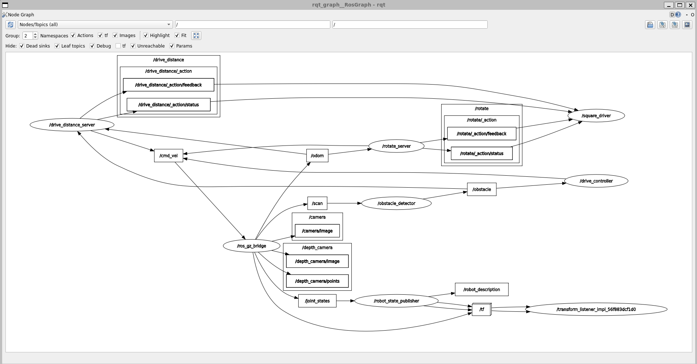

# Lab 1 Exercise: Program diffdrive_bot

This repository contains the complete implementation of **Lab 1: ROS 2 and Custom Robot Simulation** for the *Introduction to Robotics and Intelligent Systems* course.

The repository contains four ROS 2 packages designed to build and run self-contained within any ROS 2 Humble workspace.

---

## Repository Structure

```
lab1_exercise/
├── diffdrive_bot/            # Differential-drive robot description, sensors, world, and bridges
│   ├── config/bridge.yaml    # ros_gz_bridge configuration (lidar, cameras, IMU, odom, cmd_vel)
│   ├── launch/               # display.launch.py, gazebo.launch.py, control.launch.py
│   ├── urdf/                 # diffdrive_bot.urdf.xacro with depth camera & IMU additions
│   └── worlds/obstacles.sdf  # Gazebo simulation world with IMU system plugin
├── lab_interfaces/           # Base message, service, and action interfaces
│   ├── action/DriveDistance.action
│   ├── msg/ObstacleInfo.msg
│   └── srv/SetSpeed.srv
├── my_robot_interfaces/      # Custom interface definitions (ament_cmake)
│   ├── action/Rotate.action
│   ├── msg/RobotStatus.msg
│   └── srv/SetTurnSpeed.srv
├── my_robot_nodes/           # Custom Python nodes and launch files (ament_python)
│   ├── launch/square.launch.py
│   └── my_robot_nodes/
│       ├── turn_away.py      # Obstacle avoidance node with parameters and services
│       ├── rotate_server.py  # Action server rotating robot by yaw tracking
│       └── square_driver.py  # Action client executing 4-sided square trajectory
├── docs/                     # Verification screenshots
│   ├── rviz_depth_pointcloud.png
│   └── rqt_graph_square.png
└── README.md
```

---

## Requirements & Prerequisites

* **Operating System:** Ubuntu 22.04 LTS (native or WSL2)
* **ROS 2:** ROS 2 Humble (`ros-humble-desktop`)
* **Simulator:** Gazebo Harmonic with ROS 2 bridge (`ros-humble-ros-gzharmonic`)
* **Extra tools:** `ros-humble-xacro`, `ros-humble-teleop-twist-keyboard`, `ros-humble-rqt-graph`

---

## Build Instructions

To build these packages, ensure they are placed inside the `src` folder of a ROS 2 workspace (e.g. `~/ros2_ws/src`):

```bash
# 1. Source ROS 2 Humble
source /opt/ros/humble/setup.bash

# 2. Navigate to your workspace root
cd ~/ros2_ws

# 3. Build with colcon
colcon build --symlink-install

# 4. Source your workspace overlay
source install/setup.bash
```

> **Note:** If you clone this repository alongside other course material containing packages with identical names (`diffdrive_bot` or `lab_interfaces`), place a `COLCON_IGNORE` file in the other directory so colcon builds only your `lab1_exercise` packages.

---

## Running and Verifying Each Step

### Step 1: Depth Camera and IMU Verification

1. **Verify URDF Frames and Transforms:**
   ```bash
   ros2 launch diffdrive_bot display.launch.py
   ```
   In a second terminal:
   ```bash
   source /opt/ros/humble/setup.bash && source ~/ros2_ws/install/setup.bash
   ros2 run tf2_ros tf2_echo base_link depth_camera_link
   ```
   *Expected result:* Translation `[-0.215, 0.0, 0.0]` and rotation around the z-axis of approximately `3.142` rad ($180^\circ$).

2. **Verify Gazebo Simulation, Sensor Streams & RViz:**
   ```bash
   ros2 launch diffdrive_bot gazebo.launch.py
   ```
   In RViz:
   * Add an **Image** display listening to `/depth_camera/image`.
   * Add a **PointCloud2** display listening to `/depth_camera/points`.
   In a second terminal, verify the IMU stream:
   ```bash
   ros2 topic hz /imu
   ros2 topic echo /imu --once
   ```
   *Expected result:* IMU publishes at ~50 Hz, with `linear_acceleration.z` $\approx 9.8\text{ m/s}^2$ while stationary.

---

### Steps 2 to 5: Obstacle Avoidance (`turn_away` Node)

The `turn_away` node steers the robot away from obstacles using `/obstacle` messages, publishes status to `/robot_status`, and provides service endpoints for state and speed control.

1. **Launch the robot controller simulation:**
   ```bash
   ros2 launch diffdrive_bot control.launch.py
   ```

2. **Start the `turn_away` node in a second terminal:**
   ```bash
   source /opt/ros/humble/setup.bash && source ~/ros2_ws/install/setup.bash
   ros2 run my_robot_nodes turn_away
   ```

3. **Verify initial disabled state (Step 5) and status topic (Step 4):**
   ```bash
   ros2 topic echo /robot_status --once
   ```
   *Expected output:* `state: "stopped"` and the current obstacle distance.

4. **Enable the node:**
   ```bash
   ros2 service call /turn_away_enable std_srvs/srv/SetBool "{data: true}"
   ```
   *Expected result:* Robot begins driving forward at `forward_speed` (default 0.2 m/s). When approaching an obstacle, it turns in place at `turn_speed` (default 0.5 rad/s) away from the obstacle.

5. **Test dynamic parameters (Step 3):**
   ```bash
   ros2 param set /turn_away forward_speed 0.4
   ```
   *Expected result:* Robot immediately drives forward faster without needing a node restart.

6. **Test speed service (Step 5):**
   ```bash
   # Valid speed (accepted)
   ros2 service call /set_turn_speed my_robot_interfaces/srv/SetTurnSpeed "{turn_speed: 1.0}"

   # Excessive speed (rejected by max_turn_speed parameter)
   ros2 service call /set_turn_speed my_robot_interfaces/srv/SetTurnSpeed "{turn_speed: 3.0}"
   ```

7. **Disable the node:**
   ```bash
   ros2 service call /turn_away_enable std_srvs/srv/SetBool "{data: false}"
   ```
   *Expected result:* Robot publishes a single zero velocity Twist, stops immediately, and state returns to `"stopped"`.

---

### Step 6: Rotate Action Server (`rotate_server`)

1. **Keep simulation running:**
   ```bash
   ros2 launch diffdrive_bot control.launch.py
   ```

2. **Start `rotate_server` in another terminal:**
   ```bash
   source /opt/ros/humble/setup.bash && source ~/ros2_ws/install/setup.bash
   ros2 run my_robot_nodes rotate_server
   ```

3. **Send a rotation goal with live feedback:**
   ```bash
   ros2 action send_goal --feedback /rotate my_robot_interfaces/action/Rotate "{angle: 1.57}"
   ```
   *Expected result:* The robot turns $90^\circ$ to the left. The terminal displays continuous feedback climbing to ~1.57 rad, terminates with status `SUCCEEDED`, and returns the final turned angle.

4. **Inspect the new robot heading:**
   ```bash
   ros2 run tf2_ros tf2_echo odom base_link
   ```

---

### Step 7: Full Autonomous Square Routine (`square.launch.py`)

1. **Run the complete system in one command:**
   ```bash
   ros2 launch my_robot_nodes square.launch.py side_length:=0.8
   ```

2. **Inspect the computation graph in a second terminal:**
   ```bash
   source /opt/ros/humble/setup.bash && source ~/ros2_ws/install/setup.bash
   rqt_graph
   ```
   *Expected result:* Gazebo, RViz, `rotate_server`, and `square_driver` start automatically. The robot drives four sides of 0.8 m and makes four $90^\circ$ left turns, returning to its starting position.

---

## Screenshots

### Step 1: RViz Depth Image & Point Cloud
Place screenshot in `docs/rviz_depth_pointcloud.png`.


### Step 7: rqt_graph Computation Graph
Place screenshot in `docs/rqt_graph_square.png`.


---

## Technical Reflection & Implementation Notes

### 1. Cumulative Yaw vs. Direct Yaw Subtraction
In `rotate_server`, the robot's heading is measured from odometry quaternions converted to planar yaw. Because planar orientation wraps around from $+\pi$ to $-\pi$ when turning backwards, subtracting `start_yaw` from `current_yaw` causes catastrophic discontinuous jumps (e.g. from $+3.14$ to $-3.14$).
To solve this, the server integrates small incremental changes between consecutive odometry updates:
$$\Delta\psi = \text{atan2}(\sin(\psi_k - \psi_{k-1}), \cos(\psi_k - \psi_{k-1}))$$
This delta is always small and continuous regardless of coordinate quadrant boundaries.

### 2. Multi-Threaded Execution for Action Servers
In ROS 2, an action server executing a blocking loop in its goal callback will starve subscribers on the default single-threaded executor. In both `drive_distance_server` and `rotate_server`, odometry subscribers must receive live callbacks while the action loop runs. This was resolved using `ReentrantCallbackGroup` and running `rclpy.spin(node, executor=MultiThreadedExecutor())`.

### 3. Separation of CMake and Python Packages
ROS 2 Humble requires message/service/action generation packages to use the `ament_cmake` build type. Therefore, interface definitions are cleanly isolated in `my_robot_interfaces` while node logic is implemented in the `ament_python` package `my_robot_nodes`.

### 4. Known Environment Limitations
* In headless environments without hardware graphics acceleration (or when running WSL without WSLg / X11 display server configured), RViz2 and Gazebo GUI windows cannot open. In such environments, the core simulation server (`gz sim -s -r`), bridges, and ROS 2 nodes can run in headless mode.
